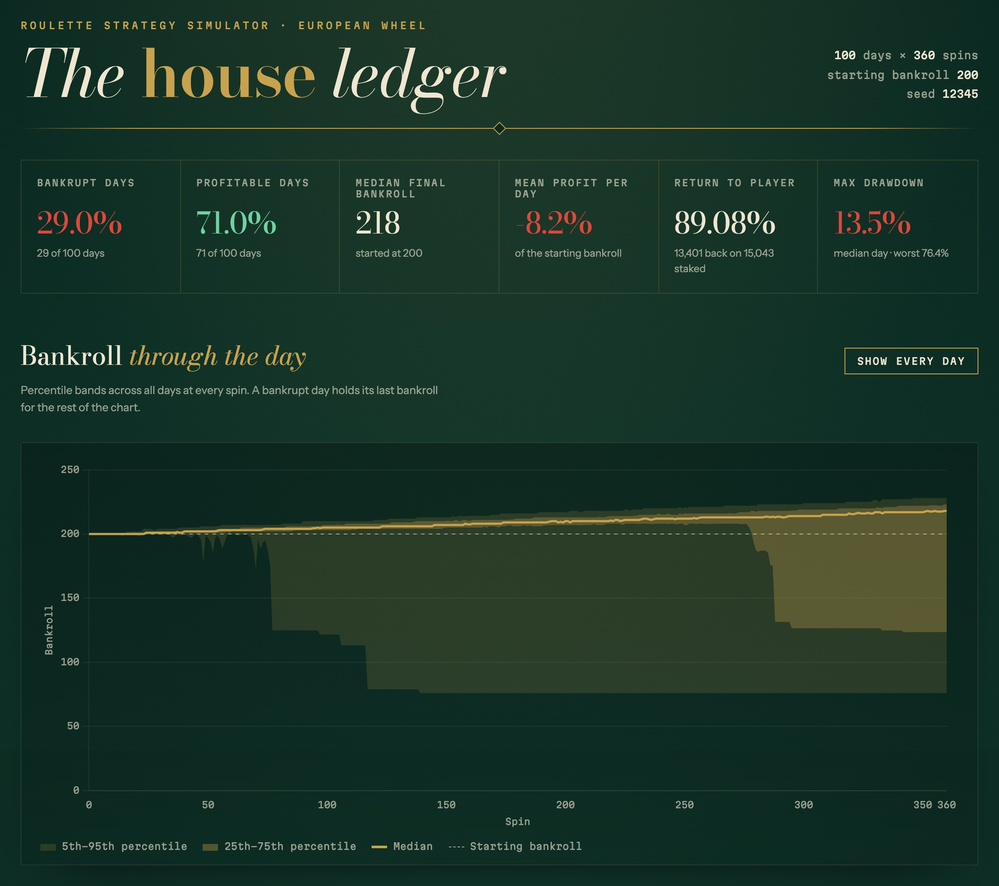
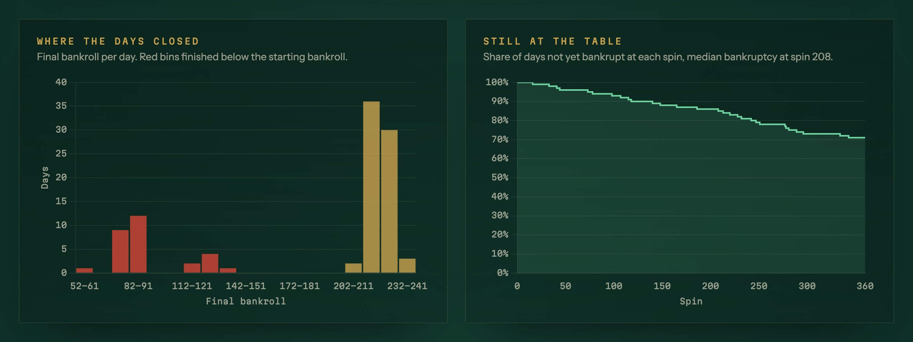
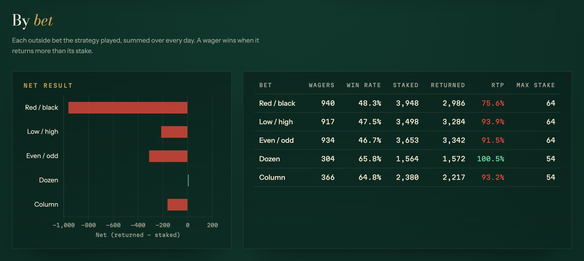
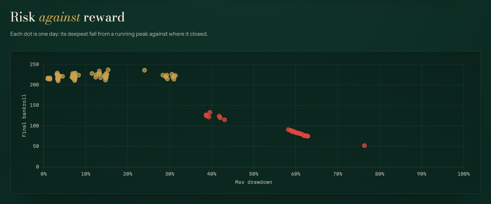
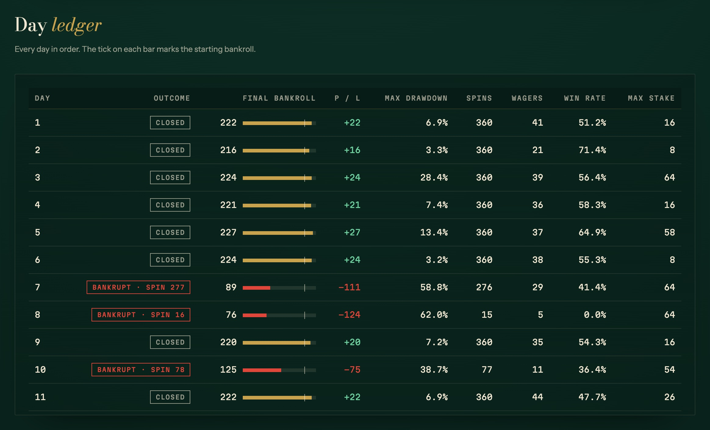

# Roulette Strategy Simulator

## Overview

I have created a simulator for European Roulette in a casino.

When playing roulette, the amount and location of your bets are important. This simulator allows you to simulate the results of executing your betting location strategy and betting amount strategy.

I couldn't find any existing programs or tools that achieve this purpose, so I decided to create one myself.

The program is written in Ruby. It is Dockerized, so it can be easily used in an environment that can run Docker.

The program is intended to specify the number of plays per day and evaluate the state at the end of the day. By default it simulates 360 spins per day for 100 days. The results are written as an HTML report with charts to `report.html`.



The screenshot is the report for `SEED=12345`. That report's HTML can be downloaded from the [v2.0.0 release](https://github.com/matsubo/roulett-strategy-simulator/releases/tag/v2.0.0).

## Requirements

- Docker
- docker-compose

## Setup

```
% git clone git@github.com:matsubo/roulett-strategy-simulator.git
% cd roulett-strategy-simulator
% docker compose build
```

## Run

Executing the simulation

```
% docker compose run app bundle exec ruby main.rb
```

When the run finishes it writes `report.html` and prints its path and the seed:

```
Report written to report.html (seed 12345)
```

Open `report.html` in a browser (`open report.html` on macOS) for the charts and tables (Chart.js is loaded from a CDN):

- Headline figures: bankrupt rate, profitable days, median final bankroll, mean daily profit, return to player, max drawdown
- Bankroll through the day: 5th–95th and 25th–75th percentile bands with the median; every day's path can be toggled on
- Distribution of final bankrolls
- Share of days still playing (not bankrupt) at each spin
- Results per outside bet: wagers, win rate, staked, returned, return to player, max stake
- Max drawdown against final bankroll for each day
- A ledger of every day

### Screenshots

Final bankroll distribution and share of days still playing



Results per outside bet



Max drawdown against final bankroll per day



Ledger of every day



### Fixing the result

Without parameters the wheel is random. Pass a number in the `SEED` environment variable to fix it; the seed printed after the run and shown in the report reproduces that run.

```
% docker compose run -e SEED=12345 app bundle exec ruby main.rb
```

### Per-spin log

Set `LOG_LEVEL=debug` to print each spin's number, stake and bankroll to standard error.

```
% docker compose run -e LOG_LEVEL=debug app bundle exec ruby main.rb
```

### Test

```
% docker compose run --rm app bundle exec rake test
```

## System Design

### Basic Design Policy

- The strategy for playing is designed to be modified and executed by changing the program. This is because it is difficult to express the original strategy without writing a program.
- The betting strategy is abstracted, allowing for easy selection of which strategy to use.
- The program is written in an object-oriented manner.

## Class Descriptions

- PlaySuite (main.rb)
  - Manages the execution of the simulator
- Roulette::Simulator::Account
  - Manages the funds account
- Roulette::Simulator::BetData
  - Manages the locations to bet on
- Roulette::Simulator::Player
  - Plays one day and returns a `DayOutcome`. The strategy to be used is determined here.
- Roulette::Simulator::DayOutcome
  - The result of one day: bankroll after each spin, the spin that went bankrupt, and tallies per bet
- Roulette::Simulator::Statistics
  - Figures over all days: percentiles, bankrupt rate, drawdowns and more
- Roulette::Simulator::Reports::Html
  - Renders the statistics as the HTML report
- Roulette::Simulator::Reward
  - Manages how much to pay out for each bet location
- Roulette::Simulator::Table
  - Represents the roulette table and the names of the locations to bet on
- Roulette::Simulator::OutsideBet
  - Represents each outside bet (color, low/high, even/odd, dozen, column): which numbers land on which side, and its payout
- Roulette::Simulator::StreakStrategy
  - Once one side comes up a set number of times in a row, bets against it and multiplies the stake by (payout + 1) after every lost bet
- Roulette::Simulator::Decisions::*
  - Decides random locations and amounts to bet on (currently unused)
